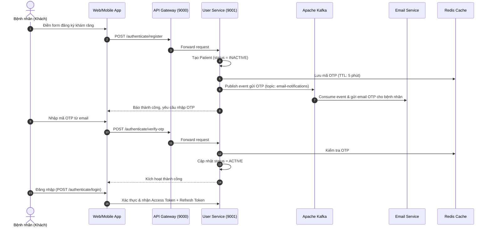
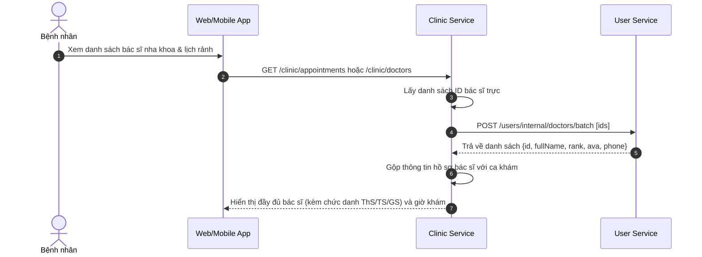

# TÀI LIỆU CHI TIẾT API - USER-SERVICE (HỆ THỐNG ĐẶT LỊCH KHÁM NHA KHOA)

## 1. TỔNG QUAN SERVICE (SERVICE OVERVIEW)

- **Tên Service:** `user-service`
- **Cổng dịch vụ trực tiếp (Port):** `9001`
- **Cổng thông qua API Gateway:** `9000` (được định tuyến qua `http://localhost:9000/users/**` và `http://localhost:9000/authenticate/**`)
- **Cơ sở dữ liệu:** PostgreSQL (`jdbc:postgresql://localhost:5432/user_service`)
- **Bộ nhớ đệm & Blacklist Token:** Redis (`localhost:6379`)
- **Message Broker:** Apache Kafka (`localhost:9092`) - Topic gửi thông báo/OTP: `email-notifications`
- **Discovery Service:** Netflix Eureka (`http://localhost:8761/eureka/`)

### 1.1. Vai trò trong Hệ thống Nha khoa
`user-service` đóng vai trò là dịch vụ cốt lõi quản lý định danh người dùng trong phòng khám nha khoa:
1. **Khách hàng / Bệnh nhân (`PATIENT`):** Đăng ký tài khoản, xác thực OTP qua email, quản lý hồ sơ cá nhân (địa chỉ, giới tính, số điện thoại) phục vụ việc đặt lịch khám răng.
2. **Bác sĩ Nha khoa (`DOCTOR`):** Quản lý hồ sơ bác sĩ chuyên khoa răng - hàm - mặt, học hàm/học vị (`PROFESSOR` - Giáo sư, `DOCTORATE` - Tiến sĩ, `MASTER` - Thạc sĩ), ảnh đại diện (avatar). Cung cấp dữ liệu bác sĩ theo lô (`batch`) cho `clinic-service` khi hiển thị danh sách lịch khám.
3. **Quản trị viên (`ADMIN`):** Quản lý toàn bộ người dùng, cấp tài khoản bác sĩ, kích hoạt, khóa/mở khóa tài khoản nhân sự.
4. **Tích hợp Thống kê:** Cung cấp số liệu thống kê bệnh nhân, tỷ lệ tăng trưởng và cơ cấu bác sĩ nha khoa cho `statistic-service`.

---

## 2. QUY CHUẨN DỮ LIỆU CHUNG (STANDARDS & CONVENTIONS)

### 2.1. Cấu trúc Response chuẩn (`ApiResponse<T>`)
Tất cả các API đều trả về định dạng JSON theo cấu trúc bao bọc chuẩn:
```json
{
  "code": 200,
  "message": "Thông điệp phản hồi (nếu có)",
  "result": { ... }
}
```

### 2.2. Danh mục Phân quyền & Vai trò (`Role`)
| Role | Mô tả trong hệ thống nha khoa |
| :--- | :--- |
| `ADMIN` | Quản trị viên phòng khám/chuỗi nha khoa, có toàn quyền hệ thống. |
| `DOCTOR` | Bác sĩ chuyên khoa răng (chỉnh nha, nhổ răng, implant, thẩm mỹ...). |
| `PATIENT` | Bệnh nhân / Khách hàng đặt lịch khám và điều trị răng. |
| `USER` | Người dùng cơ bản. |

### 2.3. Cấp bậc Bác sĩ Nha khoa (`DoctorRank`)
| Rank | Ý nghĩa |
| :--- | :--- |
| `PROFESSOR` | Giáo sư / Phó Giáo sư |
| `DOCTORATE` | Tiến sĩ Y khoa |
| `MASTER` | Thạc sĩ / Bác sĩ Chuyên khoa |

### 2.4. Trạng thái Tài khoản (`UserStatus`)
| Trạng thái | Ý nghĩa |
| :--- | :--- |
| `ACTIVE` | Tài khoản đã kích hoạt, được phép đăng nhập và sử dụng hệ thống. |
| `INACTIVE` | Tài khoản mới đăng ký, chưa kích hoạt qua OTP email. |
| `LOCKED` | Tài khoản bị quản trị viên khóa do vi phạm hoặc nghỉ việc. |

### 2.5. Bảng mã lỗi nghiệp vụ (`ErrorCode`)
| Mã Code | HTTP Status | Thông điệp lỗi | Mô tả |
| :---: | :---: | :--- | :--- |
| `200` | `200 OK` | Thành công | Request xử lý thành công |
| `400` | `400 BAD_REQUEST` | `Invalid or expired OTP` | Mã OTP không đúng hoặc đã quá hạn |
| `400` | `400 BAD_REQUEST` | `Old password is incorrect` | Mật khẩu cũ không chính xác khi đổi mật khẩu |
| `400` | `400 BAD_REQUEST` | `Email does not match with username` | Email và tên đăng nhập không khớp khi khôi phục |
| `401` | `401 UNAUTHORIZED` | `Username or password is wrong` | Sai thông tin đăng nhập |
| `401` | `401 UNAUTHORIZED` | `Unauthenticated` | Chưa đăng nhập hoặc Access Token không hợp lệ / hết hạn |
| `401` | `401 UNAUTHORIZED` | `User account is inactive` | Tài khoản chưa kích hoạt qua OTP |
| `401` | `401 UNAUTHORIZED` | `User account is locked` | Tài khoản đã bị khóa bởi quản trị viên |
| `403` | `403 FORBIDDEN` | `Do not have permission` | Không có quyền truy cập tài nguyên |
| `403` | `403 FORBIDDEN` | `Admin cannot be fixed` | Không được phép can thiệp / xóa tài khoản Super Admin |
| `404` | `404 NOT_FOUND` | `User not found` | Không tìm thấy thông tin người dùng |
| `409` | `409 CONFLICT` | `Username already exists` | Tên đăng nhập đã có người sử dụng |
| `409` | `409 CONFLICT` | `Email already exists` | Địa chỉ email đã có người sử dụng |

---

## 3. DANH SÁCH CHI TIẾT CÁC API

---

### PHẦN I: XÁC THỰC & BẢO MẬT (AUTHENTICATION & SECURITY)
> **Base Path:** `/authenticate`  
> **Route qua Gateway:** `http://localhost:9000/authenticate` hoặc trực tiếp `http://localhost:9001/authenticate`

---

#### 1. Đăng ký tài khoản Bệnh nhân (Register)
- **Endpoint:** `POST /authenticate/register`
- **Mô tả:** Dành cho bệnh nhân mới tạo tài khoản để đặt lịch khám răng. Sau khi đăng ký, tài khoản ở trạng thái `INACTIVE` và hệ thống sẽ tự sinh mã OTP gửi qua Kafka tới `email-service`.
- **Quyền hạn:** Public
- **Request Body:**
```json
{
  "username": "nguyenvana",
  "email": "vana.nguyen@example.com",
  "password": "Password@123",
  "fullName": "Nguyễn Văn A",
  "phone": "0987654321",
  "address": "123 Cầu Giấy, Hà Nội",
  "gender": "MALE"
}
```
*Ghi chú validation:*
- `username`: 3 - 50 ký tự, chỉ gồm chữ thường, số, dấu gạch dưới (`^[a-z0-9_]+$`).
- `password`: 8 - 128 ký tự, phải gồm ít nhất 1 chữ hoa, 1 chữ thường, 1 số và 1 ký tự đặc biệt.
- `gender`: `MALE`, `FEMALE`, hoặc `OTHER`.
- **Response Success (`200 OK`):**
```json
{
  "code": 200,
  "message": "User registered successfully. Please verify OTP to activate your account.",
  "result": {
    "id": 10,
    "uuid": "4f1816bc-3652-475f-b529-654cb6590ce2",
    "username": "nguyenvana",
    "email": "vana.nguyen@example.com",
    "role": "PATIENT",
    "status": "INACTIVE",
    "fullName": "Nguyễn Văn A",
    "phone": "0987654321",
    "address": "123 Cầu Giấy, Hà Nội",
    "gender": "MALE",
    "rank": null,
    "ava": null
  }
}
```

---

#### 2. Xác thực OTP kích hoạt tài khoản (Verify OTP)
- **Endpoint:** `POST /authenticate/verify-otp`
- **Mô tả:** Bệnh nhân nhập mã OTP gồm 6 chữ số nhận từ email để kích hoạt tài khoản sang trạng thái `ACTIVE`.
- **Quyền hạn:** Public
- **Request Body:**
```json
{
  "username": "nguyenvana",
  "otp": "492015"
}
```
- **Response Success (`200 OK`):**
```json
{
  "code": 200,
  "message": "User activated successfully",
  "result": {
    "id": 10,
    "username": "nguyenvana",
    "email": "vana.nguyen@example.com",
    "status": "ACTIVE",
    "role": "PATIENT",
    "fullName": "Nguyễn Văn A"
  }
}
```
- **Response Error (`400 BAD_REQUEST`):**
```json
{
  "code": 400,
  "message": "Invalid or expired OTP"
}
```

---

#### 3. Tạo lại mã OTP (Generate / Resend OTP)
- **Endpoint:** `POST /authenticate/generate-otp`
- **Mô tả:** Gửi lại mã OTP qua email trong trường hợp OTP cũ hết hạn hoặc thất lạc.
- **Quyền hạn:** Public
- **Request Body:**
```json
{
  "username": "nguyenvana"
}
```
- **Response Success (`200 OK`):**
```json
{
  "code": 200,
  "message": "OTP generated successfully",
  "result": "OTP sent to your email"
}
```

---

#### 4. Đăng nhập hệ thống (Login)
- **Endpoint:** `POST /authenticate/login`
- **Mô tả:** Đăng nhập cho Bệnh nhân, Bác sĩ nha khoa hoặc Quản trị viên. Trả về JWT Access Token và Refresh Token.
- **Quyền hạn:** Public
- **Request Body:**
```json
{
  "username": "nguyenvana",
  "password": "Password@123"
}
```
- **Response Success (`200 OK`):**
```json
{
  "code": 200,
  "message": null,
  "result": {
    "accessToken": "eyJhbGciOiJIUzI1NiJ9.eyJzdWIiOiJuZ3V5ZW52YW5hIiwiaWQiOjEwLCJyb2xlIjoiUk9MRV9QQVRJRU5UIn0...",
    "refreshToken": "6a978120-d38a-40a8-b9a2-a279df50e5eb",
    "role": "PATIENT"
  }
}
```

---

#### 5. Làm mới Access Token (Refresh Token)
- **Endpoint:** `POST /authenticate/refresh`
- **Mô tả:** Dùng Refresh Token hợp lệ còn hạn trong Redis để cấp lại Access Token mới mà không cần đăng nhập lại.
- **Quyền hạn:** Public
- **Request Body:**
```json
{
  "refreshToken": "6a978120-d38a-40a8-b9a2-a279df50e5eb"
}
```
- **Response Success (`200 OK`):**
```json
{
  "code": 200,
  "message": "Token refreshed successfully",
  "result": {
    "accessToken": "eyJhbGciOiJIUzI1NiJ9.eyJzdWIiOiJuZ3V5ZW52YW5hIi...",
    "refreshToken": "7c125641-f49c-49a7-c8a3-b184ef61f6fa",
    "role": "PATIENT"
  }
}
```

---

#### 6. Đăng xuất (Logout)
- **Endpoint:** `POST /authenticate/logout`
- **Mô tả:** Vô hiệu hóa Access Token (đưa vào Redis Blacklist cho tới thời gian hết hạn) và xóa Refresh Token tương ứng.
- **Headers:** `Authorization: Bearer <access_token>`
- **Request Body (Optional):**
```json
{
  "refreshToken": "7c125641-f49c-49a7-c8a3-b184ef61f6fa"
}
```
- **Response Success (`200 OK`):**
```json
{
  "code": 200,
  "message": "Logout successfully",
  "result": null
}
```

---

#### 7. Kiểm tra tính hợp lệ của Token (Check Token)
- **Endpoint:** `POST /authenticate/checkToken`
- **Mô tả:** Kiểm tra token có hợp lệ không (dành cho API Gateway hoặc filter nội bộ).
- **Headers:** `Authorization: Bearer <access_token>`
- **Response Success (`200 OK`):** Empty Body

---

#### 8. Đổi mật khẩu (Change Password)
- **Endpoint:** `POST /authenticate/change-password`
- **Mô tả:** Người dùng đã đăng nhập đổi mật khẩu hiện tại.
- **Headers:** `Authorization: Bearer <access_token>`
- **Request Body:**
```json
{
  "oldPassword": "Password@123",
  "newPassword": "NewPassword@456"
}
```
- **Response Success (`200 OK`):**
```json
{
  "code": 200,
  "message": "Password changed successfully",
  "result": null
}
```

---

#### 9. Quên mật khẩu (Forgot Password)
- **Endpoint:** `POST /authenticate/forgot-password`
- **Mô tả:** Bệnh nhân / Bác sĩ quên mật khẩu gửi yêu cầu, hệ thống tạo mật khẩu ngẫu nhiên mới và gửi thông báo qua email.
- **Quyền hạn:** Public
- **Request Body:**
```json
{
  "username": "nguyenvana",
  "email": "vana.nguyen@example.com"
}
```
- **Response Success (`200 OK`):**
```json
{
  "code": 200,
  "message": "Password reset successfully",
  "result": "New password sent to your email"
}
```

---

### PHẦN II: HỒ SƠ CÁ NHÂN (USER PROFILE)
> **Base Path:** `/users`

---

#### 10. Xem thông tin cá nhân của tài khoản hiện tại (Get My Info)
- **Endpoint:** `GET /users/my-info`
- **Mô tả:** Trả về đầy đủ thông tin của người dùng đang đăng nhập (Bác sĩ nha khoa xem được rank, avatar; Bệnh nhân xem được address, gender...).
- **Headers:** `Authorization: Bearer <access_token>`
- **Response Success (`200 OK` - Bệnh nhân):**
```json
{
  "code": 200,
  "message": null,
  "result": {
    "id": 10,
    "uuid": "4f1816bc-3652-475f-b529-654cb6590ce2",
    "username": "nguyenvana",
    "email": "vana.nguyen@example.com",
    "role": "PATIENT",
    "status": "ACTIVE",
    "fullName": "Nguyễn Văn A",
    "phone": "0987654321",
    "address": "123 Cầu Giấy, Hà Nội",
    "gender": "MALE",
    "rank": null,
    "ava": null
  }
}
```
- **Response Success (`200 OK` - Bác sĩ nha khoa):**
```json
{
  "code": 200,
  "message": null,
  "result": {
    "id": 2,
    "uuid": "8c450d03-e22b-4fa8-a1bf-4b360a7201c1",
    "username": "dr_minh",
    "email": "dr.minh@nhakhoa.vn",
    "role": "DOCTOR",
    "status": "ACTIVE",
    "fullName": "ThS. BS Trần Quang Minh",
    "phone": "0912345678",
    "address": null,
    "gender": null,
    "rank": "MASTER",
    "ava": "https://storage.nhakhoa.vn/avatars/dr_minh.jpg"
  }
}
```

---

#### 11. Cập nhật thông tin cá nhân (Update My Info)
- **Endpoint:** `PUT /users/my-info`
- **Mô tả:** Người dùng tự cập nhật hồ sơ cá nhân. Bệnh nhân có thể sửa họ tên, số điện thoại, địa chỉ, giới tính; Bác sĩ nha khoa có thể cập nhật avatar.
- **Headers:** `Authorization: Bearer <access_token>`
- **Request Body:**
```json
{
  "email": "vana.newemail@example.com",
  "full_name": "Nguyễn Văn An",
  "phone": "0911223344",
  "address": "Số 45 Kim Mã, Ba Đình, Hà Nội",
  "gender": "MALE",
  "ava": "https://example.com/avatar.jpg"
}
```
- **Response Success (`200 OK`):**
```json
{
  "code": 200,
  "message": null,
  "result": {
    "id": 10,
    "uuid": "4f1816bc-3652-475f-b529-654cb6590ce2",
    "username": "nguyenvana",
    "email": "vana.newemail@example.com",
    "role": "PATIENT",
    "status": "ACTIVE",
    "fullName": "Nguyễn Văn An",
    "phone": "0911223344",
    "address": "Số 45 Kim Mã, Ba Đình, Hà Nội",
    "gender": "MALE",
    "rank": null,
    "ava": null
  }
}
```

---

### PHẦN III: QUẢN TRỊ NGƯỜI DÙNG & BÁC SĨ (ADMIN USER MANAGEMENT)
> **Base Path:** `/users`  
> **Quyền yêu cầu:** `hasRole('ADMIN')`

---

#### 12. Danh sách người dùng phân trang, lọc vai trò & tìm kiếm (Get Users List)
- **Endpoint:** `GET /users`
- **Mô tả:** Admin xem danh sách người dùng. Hỗ trợ lọc theo vai trò (ví dụ: lấy riêng danh sách `DOCTOR` để gán ca trực hoặc `PATIENT` để tra cứu hồ sơ) và tìm kiếm theo từ khóa (họ tên, email/gmail, username).
- **Headers:** `Authorization: Bearer <admin_access_token>`
- **Query Parameters:**
  - `role` (Optional): `ADMIN`, `DOCTOR`, `PATIENT`, `USER`
  - `keyword` (Optional): Từ khóa tìm kiếm theo Họ tên (`fullName`), Email / Gmail (`email`) hoặc Tên đăng nhập (`username`)
  - `page` (Optional, Default: `0`): Chỉ mục trang (0-indexed)
  - `size` (Optional, Default: `10`): Số lượng bản ghi mỗi trang
  - `direction` (Optional, Default: `ASC`): Hướng sắp xếp theo `id` (`ASC` - tăng dần theo ID hoặc `DESC` - giảm dần theo ID mới nhất)
- **Example Request:** `GET /users?role=DOCTOR&keyword=minh&page=0&size=10&direction=ASC`
- **Response Success (`200 OK`):**
```json
{
  "code": 200,
  "message": null,
  "result": {
    "content": [
      {
        "id": 2,
        "uuid": "8c450d03-e22b-4fa8-a1bf-4b360a7201c1",
        "username": "dr_minh",
        "email": "dr.minh@nhakhoa.vn",
        "role": "DOCTOR",
        "status": "ACTIVE",
        "fullName": "ThS. BS Trần Quang Minh",
        "phone": "0912345678",
        "address": null,
        "gender": null,
        "rank": "MASTER",
        "ava": "https://storage.nhakhoa.vn/avatars/dr_minh.jpg"
      }
    ],
    "pageable": {
      "pageNumber": 0,
      "pageSize": 10
    },
    "totalElements": 1,
    "totalPages": 1,
    "last": true
  }
}
```

---

#### 13. Xem chi tiết người dùng theo ID (Get User by ID)
- **Endpoint:** `GET /users/{id}`
- **Mô tả:** Admin lấy thông tin chi tiết một người dùng cụ thể.
- **Headers:** `Authorization: Bearer <admin_access_token>`
- **Path Variable:** `id` (Long) - ID người dùng
- **Response Success (`200 OK`):**
```json
{
  "code": 200,
  "message": null,
  "result": {
    "id": 2,
    "uuid": "8c450d03-e22b-4fa8-a1bf-4b360a7201c1",
    "username": "dr_minh",
    "email": "dr.minh@nhakhoa.vn",
    "role": "DOCTOR",
    "status": "ACTIVE",
    "fullName": "ThS. BS Trần Quang Minh",
    "phone": "0912345678",
    "rank": "MASTER",
    "ava": "https://storage.nhakhoa.vn/avatars/dr_minh.jpg"
  }
}
```

---

#### 14. Admin tạo mới người dùng / Bác sĩ nha khoa (Create User)
- **Endpoint:** `POST /users`
- **Mô tả:** Admin khởi tạo tài khoản Bác sĩ nha khoa (kèm Rank và Avatar), Admin phụ hoặc Bệnh nhân.
- **Headers:** `Authorization: Bearer <admin_access_token>`
- **Request Body (Tạo Bác sĩ Nha khoa):**
```json
{
  "username": "dr_hoang",
  "email": "dr.hoang@nhakhoa.vn",
  "password": "Password@123",
  "fullName": "TS. BS Lê Hoàng",
  "phone": "0909123456",
  "role": "DOCTOR",
  "rank": "DOCTORATE",
  "ava": "https://storage.nhakhoa.vn/avatars/dr_hoang.jpg"
}
```
- **Request Body (Tạo Bệnh nhân):**
```json
{
  "username": "patient_lan",
  "email": "lan.pham@gmail.com",
  "password": "Password@123",
  "fullName": "Phạm Thị Lan",
  "phone": "0988776655",
  "role": "PATIENT",
  "address": "45 Lê Lợi, TP.HCM",
  "gender": "FEMALE"
}
```
- **Response Success (`200 OK`):**
```json
{
  "code": 200,
  "message": null,
  "result": {
    "id": 11,
    "uuid": "f284ab91-8dc9-4673-9a3d-3bf481a5460c",
    "username": "dr_hoang",
    "email": "dr.hoang@nhakhoa.vn",
    "role": "DOCTOR",
    "status": "ACTIVE",
    "fullName": "TS. BS Lê Hoàng",
    "phone": "0909123456",
    "rank": "DOCTORATE",
    "ava": "https://storage.nhakhoa.vn/avatars/dr_hoang.jpg"
  }
}
```

---

#### 15. Admin cập nhật thông tin người dùng theo ID (Update User)
- **Endpoint:** `PUT /users/{id}`
- **Mô tả:** Admin sửa thông tin của bất kỳ người dùng/bác sĩ nào (bao gồm đổi mật khẩu trực tiếp, thay đổi học vị bác sĩ, sửa địa chỉ bệnh nhân...).
- **Headers:** `Authorization: Bearer <admin_access_token>`
- **Path Variable:** `id` (Long)
- **Request Body:**
```json
{
  "email": "dr.hoang_updated@nhakhoa.vn",
  "password": "NewAdminPassword@123",
  "full_name": "PGS. TS Lê Hoàng",
  "phone": "0909999888",
  "rank": "PROFESSOR",
  "ava": "https://storage.nhakhoa.vn/avatars/dr_hoang_new.jpg"
}
```
- **Response Success (`200 OK`):**
```json
{
  "code": 200,
  "message": null,
  "result": {
    "id": 11,
    "username": "dr_hoang",
    "email": "dr.hoang_updated@nhakhoa.vn",
    "role": "DOCTOR",
    "status": "ACTIVE",
    "fullName": "PGS. TS Lê Hoàng",
    "rank": "PROFESSOR"
  }
}
```

---

#### 16. Xóa người dùng (Delete User)
- **Endpoint:** `DELETE /users/{id}`
- **Mô tả:** Xóa người dùng khỏi cơ sở dữ liệu. Lưu ý: Không thể xóa tài khoản Quản trị viên gốc (`CANNOT_FIX_ADMIN`).
- **Headers:** `Authorization: Bearer <admin_access_token>`
- **Path Variable:** `id` (Long)
- **Response Success (`200 OK`):**
```json
{
  "code": 200,
  "message": "User has been deleted successfully",
  "result": null
}
```

---

#### 17. Khóa tài khoản người dùng (Lock User)
- **Endpoint:** `PUT /users/{id}/lock`
- **Mô tả:** Chuyển trạng thái người dùng thành `LOCKED`. Người dùng bị khóa sẽ không thể đăng nhập hoặc dùng token để gọi API.
- **Headers:** `Authorization: Bearer <admin_access_token>`
- **Path Variable:** `id` (Long)
- **Response Success (`200 OK`):**
```json
{
  "code": 200,
  "message": "User locked successfully",
  "result": {
    "id": 10,
    "username": "nguyenvana",
    "status": "LOCKED"
  }
}
```

---

#### 18. Mở khóa tài khoản người dùng (Unlock User)
- **Endpoint:** `PUT /users/{id}/unlock`
- **Mô tả:** Mở lại quyền truy cập cho tài khoản bị khóa, chuyển trạng thái về `ACTIVE`.
- **Headers:** `Authorization: Bearer <admin_access_token>`
- **Path Variable:** `id` (Long)
- **Response Success (`200 OK`):**
```json
{
  "code": 200,
  "message": "User unlocked successfully",
  "result": {
    "id": 10,
    "username": "nguyenvana",
    "status": "ACTIVE"
  }
}
```

---

### PHẦN IV: API NỘI BỘ GIỮA CÁC MICROSERVICES (INTERNAL SERVICE APIS)
> Dành riêng cho giao tiếp Service-to-Service qua OpenFeign hoặc nội bộ mạng Microservices.

---

#### 19. Lấy danh sách Bác sĩ Nha khoa theo mảng IDs (Batch Doctors Info)
- **Endpoint:** `POST /users/internal/doctors/batch`
- **Mô tả:** Được gọi bởi `clinic-service` khi bệnh nhân xem danh sách lịch khám hoặc cuộc hẹn khám nha khoa (Appointment / ExamSession). `clinic-service` gửi mảng ID bác sĩ và nhận về thông tin đầy đủ gồm Tên, Học vị (`rank`), Avatar... để render giao diện mà không cần duplicate dữ liệu.
- **Quyền hạn:** Internal Service Call
- **Request Body:**
```json
[2, 5, 8]
```
- **Response Success (`200 OK`):**
```json
{
  "code": 200,
  "message": null,
  "result": [
    {
      "id": 2,
      "uuid": "8c450d03-e22b-4fa8-a1bf-4b360a7201c1",
      "username": "dr_minh",
      "fullName": "ThS. BS Trần Quang Minh",
      "phone": "0912345678",
      "role": "DOCTOR",
      "status": "ACTIVE",
      "rank": "MASTER",
      "ava": "https://storage.nhakhoa.vn/avatars/dr_minh.jpg"
    },
    {
      "id": 5,
      "uuid": "e9b213f0-4562-4aa8-bbf3-1a2c3d4e5f60",
      "username": "dr_huong",
      "fullName": "TS. BS Nguyễn Thu Hương",
      "phone": "0934567890",
      "role": "DOCTOR",
      "status": "ACTIVE",
      "rank": "DOCTORATE",
      "ava": "https://storage.nhakhoa.vn/avatars/dr_huong.jpg"
    }
  ]
}
```

---

#### 20. Thống kê tổng quan Bệnh nhân (Patient Overview Statistic)
- **Endpoint:** `GET /users/internal/statistics/patient-overview`
- **Mô tả:** Cung cấp cho `statistic-service` dữ liệu số lượng bệnh nhân khám răng mới trong tháng được chọn và tỷ lệ tăng trưởng so với tháng trước đó.
- **Query Parameters:**
  - `month` (int, 1-12)
  - `year` (int, ví dụ 2026)
- **Example Request:** `GET /users/internal/statistics/patient-overview?month=10&year=2026`
- **Response Success (`200 OK`):**
```json
{
  "code": 200,
  "message": null,
  "result": {
    "totalPatients": 350,
    "growthRate": 12.5,
    "month": 10,
    "year": 2026
  }
}
```

---

#### 21. Thống kê cơ cấu Bác sĩ Nha khoa (Doctor Overview Statistic)
- **Endpoint:** `GET /users/internal/statistics/doctor-overview`
- **Mô tả:** Cung cấp cho `statistic-service` tổng số lượng bác sĩ nha khoa trong toàn hệ thống và phân bổ theo trình độ (Giáo sư, Tiến sĩ, Thạc sĩ).
- **Response Success (`200 OK`):**
```json
{
  "code": 200,
  "message": null,
  "result": {
    "totalDoctors": 18,
    "professors": 2,
    "doctorates": 6,
    "masters": 10
  }
}
```

---

#### 22. Biểu đồ tăng trưởng Bệnh nhân (Patient Growth Timeline Statistic)
- **Endpoint:** `GET /users/internal/statistics/patients/growth`
- **Mô tả:** Cung cấp dữ liệu chuỗi thời gian số lượng bệnh nhân mới đăng ký khám nha khoa để vẽ biểu đồ đường/cột trong trang Dashboard quản trị.
- **Query Parameters:**
  - `from`: Ngày bắt đầu định dạng `yyyy-MM-dd` (ví dụ `2026-01-01`)
  - `to`: Ngày kết thúc định dạng `yyyy-MM-dd` (ví dụ `2026-10-31`)
  - `groupBy` (Default: `MONTH`): Nhóm theo `DAY`, `WEEK`, `MONTH`
- **Example Request:** `GET /users/internal/statistics/patients/growth?from=2026-01-01&to=2026-10-31&groupBy=MONTH`
- **Response Success (`200 OK`):**
```json
{
  "code": 200,
  "message": null,
  "result": {
    "timeline": [
      { "period": "2026-08", "newPatients": 45 },
      { "period": "2026-09", "newPatients": 60 },
      { "period": "2026-10", "newPatients": 78 }
    ],
    "totalInRange": 183
  }
}
```

---

## 4. LUỒNG HOẠT ĐỘNG CHÍNH (TYPICAL BUSINESS WORKFLOWS)

### 4.1. Luồng Bệnh nhân đăng ký và đặt lịch khám răng


### 4.2. Luồng Clinic Service hiển thị danh sách Bác sĩ Nha khoa & Lịch khám


---

## 5. ĐỀ XUẤT CÁC CẢI TIẾN & MỞ RỘNG CHO CHUYÊN KHOA NHA KHOA (DENTAL-SPECIFIC RECOMMENDATIONS)

Để hệ thống đặt lịch khám chuyên về răng được hoàn thiện và sát với nghiệp vụ phòng khám thực tế hơn, các trường dữ liệu và API sau đây được đề xuất bổ sung:

1. **Bổ sung Chuyên khoa Răng của Bác sĩ (`DoctorSpecialty`):**
   - Hiện tại bảng `doctors` mới chỉ có `rank` (học hàm/học vị). Nên bổ sung trường chuyên môn:
     - `ORTHODONTICS`: Chỉnh nha - Niềng răng
     - `IMPLANTOLOGY`: Cấy ghép Implant
     - `COSMETIC_DENTISTRY`: Nha khoa thẩm mỹ (Bọc răng sứ, dán Veneer, tẩy trắng răng)
     - `ENDODONTICS`: Điều trị tủy răng & sâu răng
     - `ORAL_SURGERY`: Tiểu phẫu (Nhổ răng khôn, phẫu thuật nướu)
     - `PEDIATRIC_DENTISTRY`: Nha khoa trẻ em
2. **API Tra cứu công khai danh sách Bác sĩ Nha khoa (Public Doctor Catalog):**
   - Bổ sung `GET /users/doctors/public` cho phép khách hàng chưa đăng nhập cũng có thể xem danh sách các bác sĩ, học vị, ảnh đại diện, số năm kinh nghiệm và chuyên môn để chọn bác sĩ điều trị trước khi đặt lịch.
3. **Tiền sử bệnh răng miệng của Bệnh nhân (`DentalMedicalHistory`):**
   - Thêm trường hoặc bảng phụ thuộc cho `Patient`: Tiền sử dị ứng thuốc tê, bệnh tim mạch, máu khó đông, phụ nữ có thai (rất quan trọng khi nhổ răng hoặc phẫu thuật nha khoa).
